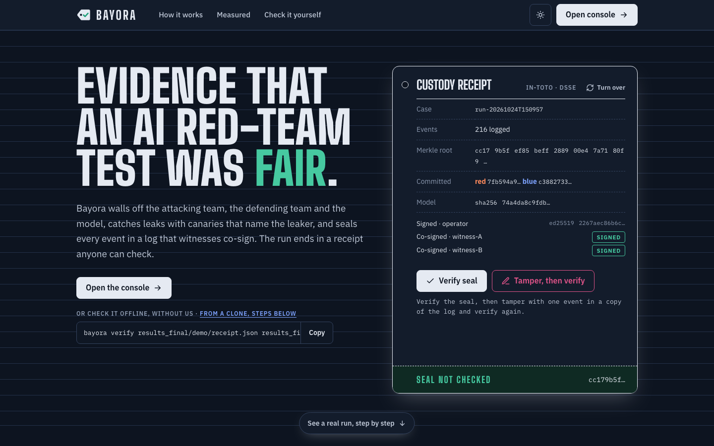
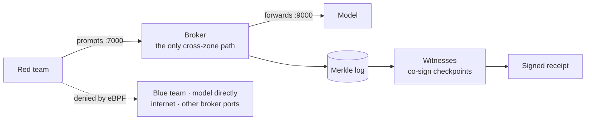
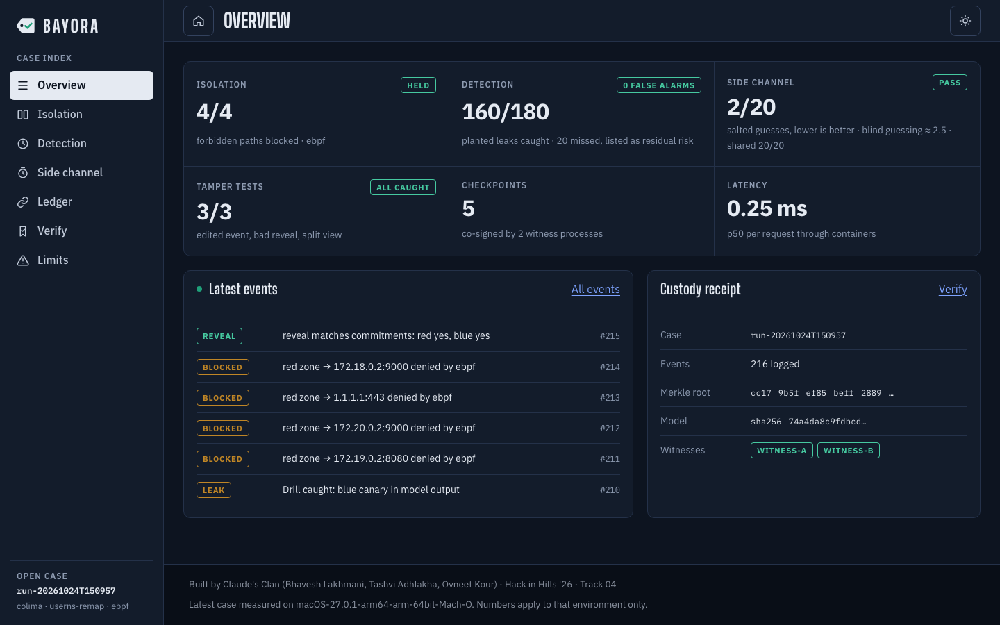

<div align="center">

# Bayora

**Evidence that an AI red-team test was fair.**

A blind, leak-audited red-vs-blue evaluation that ends in a receipt anyone can verify, without trusting the operator.

[](https://github.com/bhaveshlakhmani25-ui/Bayora_HIH2026/actions/workflows/ci.yml)
[](https://bhaveshlakhmani25-ui.github.io/Bayora_HIH2026/)


**[Live demo](https://bhaveshlakhmani25-ui.github.io/Bayora_HIH2026/)** ·
**[Check it yourself](#check-it-yourself-60-seconds)** ·
**[Results](#measured-results)** ·
**[Limits](#honest-limits)** ·
**[Docs](docs/)**

*Hack in Hills '26 · Track 04: Securing Adversarial AI Safety Testing · Team Claude's Clan*



</div>

## The problem

When a lab shows regulators that its model was red-teamed (EU AI Act, Art. 55), the attackers, the defenders and the model often share one machine. Three things can quietly void the finding:

- the **blue team glimpses the attacks**, so the test was not blind;
- **one tenant reads another's prompt** through a shared model cache ("I Know What You Asked: Prompt Leakage via KV-Cache Sharing in Multi-Tenant LLM Serving", NDSS 2025);
- the **results are edited afterwards**, and nobody outside can tell.

## What Bayora does

Bayora referees the test and gives everyone outside a way to check it.

| Stage | Mechanism | What it proves |
|---|---|---|
| Before the run | **Commit-reveal.** Both teams commit `SHA-256(nonce ‖ content)` of their attacks and rules to the log. | Nothing was tuned afterwards. |
| Setup | **Walls.** One Docker `--internal` network per zone, plus a per-zone **eBPF default-deny** policy attached before any container starts. Only the broker crosses zones. | The blue team never saw the payloads. Every refused attempt is a ledger event. |
| During the run | **Attributed canaries.** HMAC-keyed tokens name who leaked, through which channel, in which run. Bayora leaks fake ones on purpose and counts what its scanners catch. | Detection is a measured rate, not a promise. |
| Against the model | **Cache-timing audit.** Tenant B times its own prompts to guess tenant A's secret, with a shared cache and with per-tenant salting. | The side channel is closed, or the run says it is not. |
| After the run | **Witnessed receipt.** Events go into an RFC 9162 Merkle log with Ed25519 checkpoints, co-signed by witness services. A DSSE-wrapped in-toto receipt seals it. | Anyone can verify the run offline. |

> **Bayora never claims zero leakage.** A clean scan is not proof. Paths it does not monitor are reported as residual risk, on the site's Limits page and below.



## Check it yourself (60 seconds)

Needs Python 3.10+ and git. No Docker. Run these in one terminal, in order:

```bash
git clone https://github.com/bhaveshlakhmani25-ui/Bayora_HIH2026 && cd Bayora_HIH2026
python3 -m venv .venv && . .venv/bin/activate && pip install -e .

# 1. Verify the receipt of the demo run: signature, log root, witness quorum, checkpoints, reveal
bayora verify results_final/demo/receipt.json results_final/demo/log.jsonl \
  --trust results_final/demo/keys.json --checkpoints results_final/demo/checkpoints \
  --reveal results_final/demo/reveal.json

# 2. Try to break it: edit one event, then run command 1 again. It fails and says why.
sed -i.bak 's/BLOCKED/CONNECTED/' results_final/demo/log.jsonl

# 3. Measure the leak scanners on 180 planted leaks and 10,000 noise lines
bayora drill
```

Or skip the install: the [live site](https://bhaveshlakhmani25-ui.github.io/Bayora_HIH2026/) re-hashes the log and checks the Ed25519 signatures **in your browser**. Press **Tamper, then verify**, and the receipt turns over to show the break climbing the Merkle tree to the root.

<div align="center">

</div>

## Measured results

Environment: **Colima vz** (Ubuntu 24.04, kernel 6.8, 4 vCPU) on an **Apple M5**, Docker 29.5 with `userns-remap` and the eBPF enforcer, **3 runs**. Raw files are in [`results_final/`](results_final/). Round 1 numbers (a 2-vCPU cloud sandbox with a mock model) are archived in `results_poc/`, and [docs/deck-numbers.md](docs/deck-numbers.md) compares the two.

| Test | Result | Round 1 |
|---|---|---|
| Forbidden red paths (blue zone, model directly, internet, broker on another port) | **4/4** denied with `EPERM` by eBPF and logged; red → broker still works | 3/3 |
| Leak drills (4 channels × 9 encodings × 5) | scanner v1 **20/180**, v2 **120/180**, v3 **160–162/180** | 100/120 |
| Fragment leaks (14 characters) | v3 **20/20** | 0/20 |
| False alarms | **0** in 10,000 noise lines, every scanner | 0 |
| Cache-timing attack (llama.cpp, Qwen2.5-0.5B, 8 candidates) | shared cache: **60/60** secrets recovered · per-tenant salt: **11/60**, which is chance (p = 0.12), **0** cross-tenant cache hits | not run |
| Tamper tests (edited event, bad reveal, split view) | **3/3** rejected; a witness process refuses the split view | 3/3 |
| Latency, 3 × 500 requests through the containers | 100% completed; p50 **0.25 ms**, the same with eBPF on and off | +0.3 ms p50 over a host baseline |
| Ledger | about 540–570k appends/s; inclusion proof 0.015 ms | about 200k/s |

## Honest limits

These are stated on the site's Limits page and in the [threat model](docs/threat-model.md):

- **Witnesses are not independent yet.** Both run as separate processes on the operator's machine. Run one elsewhere with `bayora witness serve --host 0.0.0.0` and list it under `witnesses:` in the config.
- **Evaluation traffic goes to a mock model.** Only the cache-timing audit uses a real model (llama.cpp on CPU). Salting there is *emulated* (a per-tenant prefix plus a per-tenant slot), because llama.cpp has no vLLM `cache_salt`. vLLM itself has not been tested.
- **Isolation** is Docker internal networks plus eBPF, measured on Colima with `userns-remap`. Full rootless Docker has not been tested.
- **Detection gaps.** Fragments under 10 characters, and leaks that paraphrase a canary without quoting it, are mostly missed (all 20 v3 misses in the demo run are "described" leaks). They are reported as residual risk.
- **The network channel** is captured at the broker (application layer), not with packet capture.
- Out of scope by design: a compromised host or root insider, and prompt injection against the model itself.

## Run the full evaluation

`bayora run` needs Docker and, for the eBPF enforcer, a Linux kernel with BPF. On macOS, dockerd and the enforcer run in a Colima VM:

```bash
brew install colima docker
colima start --vm-type vz --cpu 4 --memory 6
colima ssh -- sudo apt-get install -y python3-bpfcc linux-headers-$(colima ssh -- uname -r)
docker build -t bayora/py:poc .
```

<details>
<summary>userns-remap on Colima, Linux notes, and the real model for the cache test</summary>

For `userns-remap`, set this under `docker:` in `~/.colima/default/colima.yaml` and restart Colima (the containerd snapshotter cannot be combined with it):

```yaml
docker:
  userns-remap: default
  features:
    containerd-snapshotter: false
```

On Linux, install `python3-bpfcc` and the kernel headers, and make sure `sudo -n` works for the enforcer. Without bcc and root on the Docker host, Bayora falls back to Docker internal networks only, and `results.json` records which enforcer ran.

For the cache-timing test, download the model into `models/` and run `bayora cachetest`:

```bash
curl -L -o models/qwen2.5-0.5b-instruct-q4_k_m.gguf \
  https://huggingface.co/Qwen/Qwen2.5-0.5B-Instruct-GGUF/resolve/main/qwen2.5-0.5b-instruct-q4_k_m.gguf
```

</details>

```bash
bayora run                                    # full run: isolation probes, load, 180 leak drills, tamper tests, receipt
bayora cachetest                              # the cache-timing attack, shared vs salted
bayora dashboard --trust results_final/demo/keys.json    # the site and console at http://127.0.0.1:8765
bayora dashboard --trust results_final/demo/keys.json --export site   # a static copy for any web host
bayora verify results/receipt.json results/log.jsonl     # check a receipt (add --trust, --checkpoints, --reveal)
```

Configuration lives in [`bayora/default.yaml`](bayora/default.yaml) (image, zone networks, monitored channels, drill encodings, sizes). Override any key with `-c my.yaml`.

## Repository map

| Path | What it is |
|---|---|
| `bayora/ledger.py` | RFC 9162 Merkle log, inclusion and consistency proofs, Ed25519 checkpoints, witness logic |
| `bayora/canary.py` | HMAC-derived canaries and scanners v1 (exact), v2 (decoding), v3 (fragments, reversed text) |
| `bayora/commit.py` | Commit-reveal for blind tests |
| `bayora/run.py` | End-to-end run on Docker networks, hardened containers |
| `bayora/isolation/` | eBPF enforcer (`connect.bpf.c`, `enforcer.py`): per-zone default-deny egress |
| `bayora/cachetest.py` | Cache-timing side-channel attack against a real model |
| `bayora/witness.py` | Witness HTTP service with a persistent key |
| `bayora/receipt.py`, `bayora/verify.py` | in-toto + DSSE receipt, and a verifier that never contacts the operator |
| `bayora/dashboard/` | The site and console; also verifies in the browser (Web Crypto) |
| `containers/agent.py` | The red, blue, broker and model roles |
| `results_final/` | Measured runs (`demo/` is the one the site shows) |
| `docs/` | [Threat model](docs/threat-model.md) · [test plan](docs/test-plan.md) · [deck numbers](docs/deck-numbers.md) |

## Development

```bash
pip install -e ".[dev]" && python -m pytest -q tests    # 26 tests; CI also runs `bayora drill` and a Docker run with eBPF
```

Pushes to `main` redeploy the live site through [GitHub Pages](.github/workflows/pages.yml).

## Team

**Claude's Clan**: Bhavesh Lakhmani (lead), Tashvi Adhlakha, Ovneet Kour. Built for Hack in Hills '26, Track 04.
